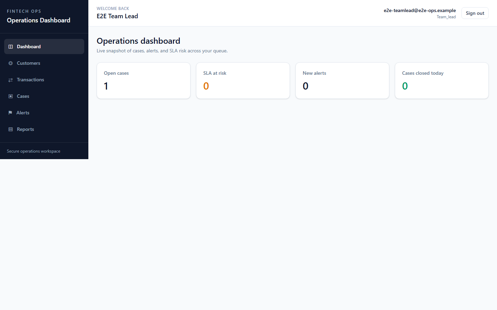
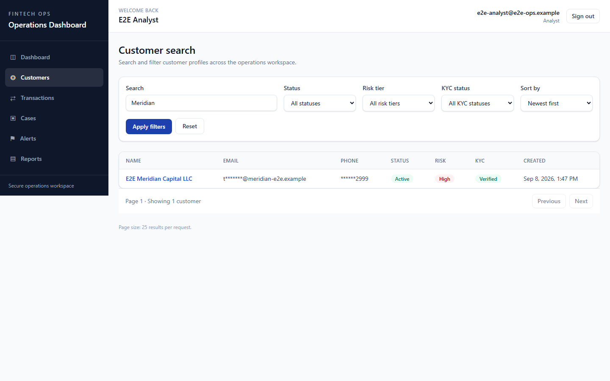
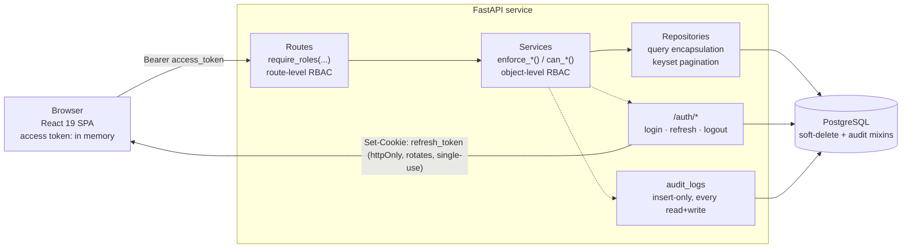
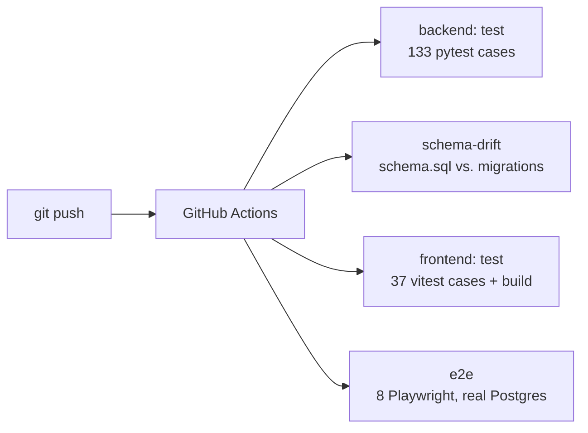
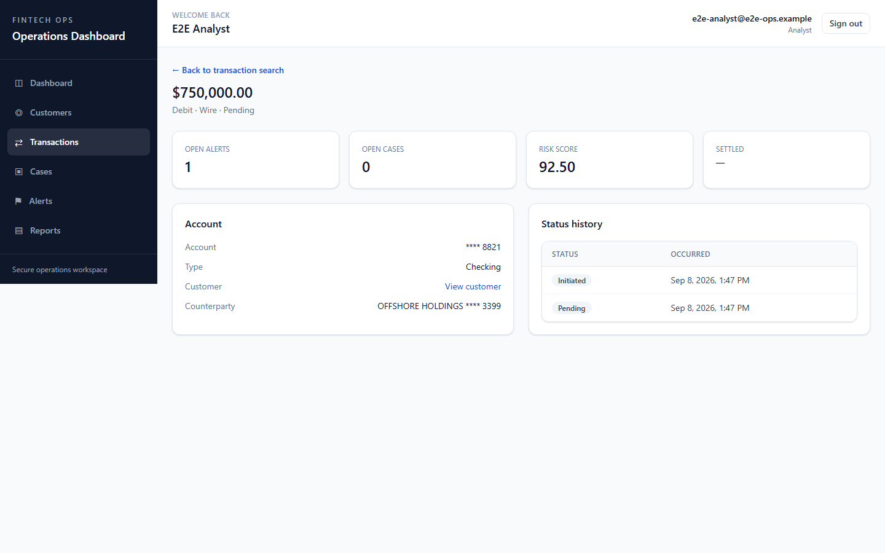
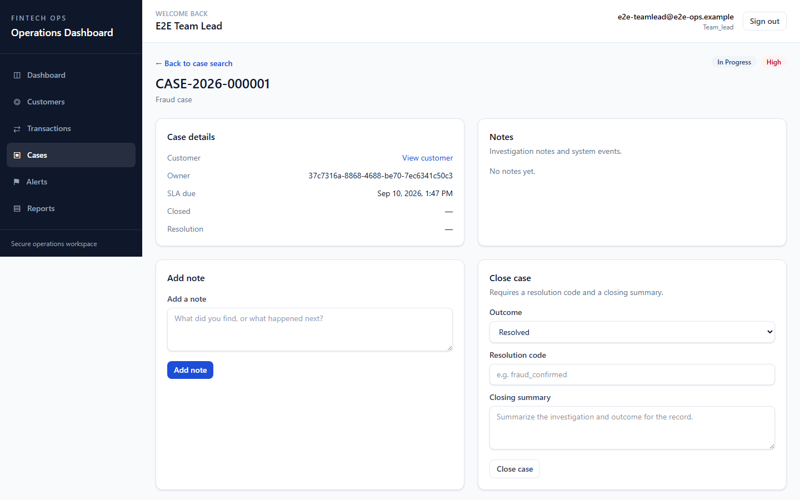
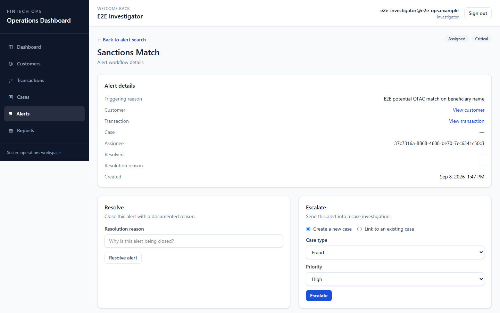
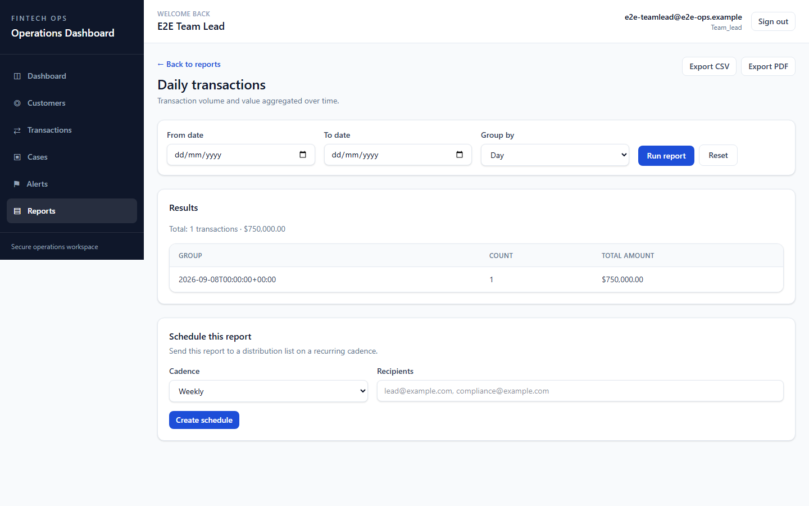

# Fintech Operations Dashboard — Case Study

A full-stack internal platform for a fintech's support, fraud, and compliance desk — customer lookup, transaction review, case management, alert triage, and reporting, unified behind role-based access control and a complete audit trail. Designed, built, secured, and shipped solo across schema, API, UI, and CI/CD.

| | |
|---|---|
| **Automated tests** | 178, gating every push |
| **RBAC roles** | 5, enforced at 2 layers |
| **Schema migrations** | 9, all reversible |
| **CI jobs** | 4, across 2 workflows |
| **Stack** | FastAPI (async) · SQLAlchemy 2.0 · PostgreSQL · Alembic · React 19 · TypeScript · TanStack Query · Tailwind CSS v4 · Playwright · GitHub Actions |

*The operations dashboard — live counts of open cases, SLA risk, and new alerts for the signed-in analyst's queue. A 60-second walkthrough is at [docs/walkthrough.mp4](docs/walkthrough.mp4).*

---

## 1. Project summary

An internal operations dashboard that gives a fintech's support, fraud, and compliance teams one system of record instead of three disconnected ones. It covers the full lifecycle a case actually follows in the real world: a transaction trips a fraud rule, an alert lands in the queue, an investigator triages and escalates it into a case, the case gets worked and closed with a documented resolution — and every step of that thread, plus every read of sensitive customer data along the way, lands in an immutable audit log.

The backend is an async FastAPI service on PostgreSQL with a layered repository/service architecture; the frontend is a React 19 + TypeScript single-page app with role-aware UI gating that mirrors the backend's permissions exactly. Both sides carry their own CI: 133 backend tests, 37 frontend unit tests, and a full Playwright end-to-end suite that spins up a real Postgres instance and drives the actual app through a browser — all gating every push via GitHub Actions.

It was built the way a real engineering org actually ships this kind of system: an architecture design pass, a staff-level code review, a full security audit, and a release-readiness review — each one followed all the way through to implementing every remediation, not just producing a findings list.

## 2. The business problem

Fraud, support, and compliance teams at a fintech typically work across tools that don't talk to each other: a ticketing system for cases, a separate vendor tool for fraud alerts, spreadsheets for reporting, and raw database or read-replica access for transaction lookups. That fragmentation has two direct costs.

**Cost 1 — Speed: slower case resolution.** Analysts context-switch between systems to answer one question: "what happened, who's already looked at it, and what did they decide?" An alert and the case it becomes have no structural link, so that history has to be reconstructed by hand every time.

**Cost 2 — Risk: audit and regulatory exposure.** Regulators expect a defensible, timestamped record of who accessed what customer data and why an alert was actioned a certain way. Spreadsheet-based tracking and ad-hoc database access can't reliably produce that trail on demand.

The dashboard was scoped around four personas from the actual requirements spec: a Tier 1/2 support analyst, a fraud/AML investigator, an operations team lead who owns SLA and audit-readiness, and a platform admin managing access. Each persona maps directly onto one of the five backend roles, and the UI shows each of them a different, narrower slice of the same system rather than one generic view with hidden permission checks.

*Customer search — a Tier 1/2 analyst's entry point, with status, risk-tier, and KYC filters and masked PII in the results.*

## 3. Architecture

A conventional layered backend (routes → services → repositories → database) paired with a feature-folder React frontend, connected by a JWT access token / httpOnly rotating refresh token pair — and a CI pipeline positioned as part of the architecture, not an afterthought, since it's what actually enforces every rule below.

**Backend layering.** FastAPI routes depend only on services (never touch the database directly); services depend on repositories and hold every business rule — status-transition validation, object-level permission checks, audit-log writes; repositories hold nothing but query construction. Every dependency is constructor-injected through FastAPI's own DI graph, so a service can be unit-tested against fake repositories with no database at all.

**Frontend.** One feature folder per domain (customers, cases, alerts, transactions, reports), each with its own API client, TanStack Query hooks, and components. A single `<Can permission="...">` gate and a table of permission tuples mirror the backend's role tables exactly, so a button an analyst can't actually use is a button they never see.

*Transaction detail — a flagged $750,000 wire with its computed risk score, masked counterparty, and status history.*

**Data.** The domain schema — users/roles, customers/accounts/transactions, cases/notes/links, alerts, reports, and an insert-only audit log — carries soft-delete and timestamp mixins uniformly, and every list endpoint uses keyset (cursor) pagination instead of `OFFSET`.

## 4. Technical challenges

The interesting bugs in this project weren't in the code that was written carelessly — they were in the gaps between two pieces of correct-looking code that made different assumptions.

**Challenge:** A hand-maintained `schema.sql` reference document and the real source of truth (Alembic migrations) had nothing enforcing agreement between them.
**What it turned up:** Building a structural diff tool to compare the two surfaced real, silent drift: **10 missing indexes and all 10 `updated_at` triggers** that the docs had described since day one but no migration had ever created, plus CHECK constraints missing on five enum-like columns across `alerts` and `reports` — the database had been accepting arbitrary strings in those columns since the very first migration.

**Challenge:** Migrating the refresh-token flow from a JSON body to an httpOnly cookie on the backend, with no shared type contract between the Pydantic response schema and the frontend's TypeScript types.
**What it turned up:** The frontend kept compiling clean — `TokenResponse.refresh_token` still typed as a required string — while the backend silently stopped sending it. Sessions couldn't survive past the access token's 30-minute lifetime in any deployment where a dev proxy wasn't masking the gap. Found by re-reading the integration, not by a type error, because there was no shared type to fail.

**Challenge:** React 18/19 `StrictMode` double-invokes a component's mount effect in development — and the silent session-restore call on mount raced against a refresh token that's single-use by design.
**What it turned up:** Two near-simultaneous `/auth/refresh` calls, one of which always lost the race and 401'd — bouncing a user with a perfectly valid session back to the login screen. Fixed by routing the mount-time bootstrap through the same single-flight promise lock already guarding the 401-retry path, so concurrent callers share one in-flight request instead of firing two.

**Challenge:** An end-to-end suite that passed reliably on a local machine failed on the very first run in a clean GitHub Actions checkout.
**What it turned up:** Playwright's config hardcoded a path to a Python virtualenv (`backend/.venv/bin/python`) that had simply always existed locally from earlier development and was never actually created by the CI job. A clean environment has no memory of your machine's history — the fix was one line, but only a real clean-room run would have found it.

## 5. Solutions implemented

Each of these closes a specific gap above — none of them are speculative hardening; every one traces back to a review finding, a bug, or a documented requirement.

- **Two-layer RBAC.** Route-level `require_roles(...)` dependencies gate every endpoint; object-level `enforce_*`/`can_*` predicates in the service layer add ownership and status checks `require_roles` can't express — e.g. an analyst may only view or modify a case they own, and only a team lead or admin may reassign one. The frontend's permission table was rebuilt to match these exact per-action tuples instead of one umbrella "can write" flag.

*Case detail — the notes/close-case actions above are RBAC-gated per role; there's no dedicated audit-trail screen (the audit log is backend-only), so this per-action gating is the clearest visible RBAC signal in the UI.*

*Alert triage — a critical sanctions-match alert with resolve and escalate-to-case actions, each writing to the audit log.*
- **httpOnly, single-use, rotating refresh tokens.** Access tokens live in memory on the client and carry a `token_version` claim for immediate revocation on logout. The refresh token never reaches JavaScript at all — it's a path-scoped httpOnly cookie, rotated and invalidated on every use, with a single-flight lock shared across every code path that might need a fresh token.
- **A schema-drift CI gate.** A script that builds one database from `schema.sql` and another from `alembic upgrade head`, reflects both structurally, and fails the build on any real difference in tables, columns, indexes, or CHECK constraints — plus two migrations that closed every gap it found on first run.
- **178 automated tests across three layers.** 133 backend tests (unit, service, API, integration), 37 frontend unit tests, and 8 Playwright end-to-end tests — including a regression test that renders the auth provider under `StrictMode` specifically to keep the refresh-token race from silently coming back.

## 6. Security considerations

Arrived at through an actual audit cycle — JWT security, authorization, injection classes, XSS, CSRF, secrets management, and logging were each evaluated, then remediated, then re-verified — not designed once from a checklist and left alone.

| Area | What's actually in place |
|---|---|
| **Session security** | Short-lived signed JWT access tokens (30 min, HS256) with a revocation claim; single-use, rotating refresh tokens in httpOnly, path-scoped cookies the client-side JS can never read. |
| **Authorization** | Two-layer RBAC across five roles (analyst, investigator, team lead, compliance auditor, admin), enforced at both the route and the individual-resource level. |
| **Secrets at rest** | TOTP MFA secrets Fernet-encrypted under a key kept independent of the JWT signing key; startup guards refuse to boot with a default secret when `APP_ENV=production`. |
| **Injection defense** | Parameterized queries via SQLAlchemy throughout (no raw string interpolation), Pydantic validation at every request boundary, and formula-injection escaping on CSV report exports. |
| **Abuse resistance** | Per-IP rate limiting on authentication endpoints plus exponential-backoff account lockout after repeated failed logins. |
| **Auditability** | An insert-only `audit_logs` table capturing every sensitive read, every write, the actor's IP address, and every `access_denied` event — not just the actions that succeeded. |

## 7. Performance optimizations

Optimized for the access patterns the app actually has — long lists that grow without bound, fuzzy name/email/phone search, and a client that shouldn't make a network call it doesn't need to.

- **Keyset pagination everywhere.** Every list endpoint pages on a `(created_at, id)` cursor instead of `OFFSET`, so page 500 costs the same as page 1 instead of degrading linearly as the table grows.
- **Trigram search indexes.** `pg_trgm` GIN indexes on customer name, email, and phone give sub-second fuzzy search without a leading-wildcard sequential scan.
- **Partial indexes.** Nearly every index is scoped `WHERE deleted_at IS NULL`, so soft-deleted rows — which never appear in a live query — never bloat the index that serves it.
- **Single-flight token refresh.** N concurrent requests hitting a 401 at once produce exactly one `/auth/refresh` call, not N, via a shared in-flight promise.
- **Precise cache invalidation.** Hierarchical TanStack Query key factories mean closing one case invalidates that case's detail and case lists — not every query in the app.

*Reporting — an aggregated transaction-volume report with CSV/PDF export and a scheduling panel, gated to team lead/compliance/admin roles.*

## 8. Lessons learned

> A shared contract between backend and frontend isn't a nice-to-have. Its absence was the direct cause of the one regression that actually shipped in this project — the compiler had nothing to fail on, because there was nothing shared to check against.

- **Documentation-as-code only stays true if something enforces it.** `schema.sql` looked authoritative and was quietly wrong in a dozen places relative to the migrations that actually ran — for as long as nothing compared the two.
- **The most valuable regression test exercises the real integration point.** The StrictMode/refresh-token race was only reproducible by rendering the real auth provider against the real API client — a test that mocked either one away would have passed right through it.
- **"Works locally" and "works in CI" are different claims.** A clean checkout surfaces every assumption local dev quietly carries forward from a machine's history.
- **Review cycles compound.** Most of the real fixes in this project came from a second or third pass over the same code, not the first — architecture review, then security audit, then release-readiness review, each one finding what the last one's fixes had exposed.

## 9. Resume bullet points

Ready to drop into a resume or LinkedIn project entry — each one is a real, verifiable claim from the build.

- Designed and built a full-stack fintech operations platform (FastAPI/PostgreSQL + React/TypeScript) implementing two-layer RBAC across 5 roles, with route-level and object-level permission enforcement mirrored exactly in the UI.
- Migrated session authentication from JSON-body refresh tokens to httpOnly rotating cookies; diagnosed and fixed a React 18 StrictMode concurrency race against the single-use token via a shared single-flight refresh lock.
- Built a custom schema-drift CI check that structurally diffs a hand-maintained schema reference against live Alembic migrations, surfacing and closing 10 missing indexes, 10 missing triggers, and 5 missing data-integrity constraints via two new reversible migrations.
- Led a self-directed security audit covering JWT handling, authorization, injection classes, XSS/CSRF, secrets management, and logging; implemented every remediation, including Fernet-encrypted MFA secrets, exponential-backoff account lockout, and structured audit logging of access-denied events.
- Established a 178-test automated suite (backend unit/integration, frontend unit, Playwright E2E) gated in GitHub Actions across 4 CI jobs and 2 workflows, including a Postgres-backed end-to-end run on every push.
- Implemented keyset/cursor pagination and trigram-indexed fuzzy search across the customer, transaction, case, and alert domains to keep list and search performance flat as tables grow.

## 10. Interview talking points

Framed as answers to the questions these actually invite.

**Q: Tell me about a bug you're proud of finding.**
- The React StrictMode / refresh-token race: two silently-fired session-restore calls competed for a single-use refresh token, and only one could win.
- Explain *why* it was subtle — StrictMode's double-invoke is dev-only, so it wouldn't fail the same way in production, but it exposed a real missing guarantee (no single-flight protection) that a production race — two tabs, a flaky network retry — could trigger too.
- The fix is small (route one more call through an existing lock); the diagnosis — reading the network trace, recognizing the pattern, writing a test that reproduces it under StrictMode on purpose — is the actual story.

**Q: How do you approach security in a system like this?**
- Not as a checklist applied once — as a cycle: audit against specific categories (JWT, authz, injection, XSS/CSRF, secrets, logging), implement every finding, and expect the next pass to find more.
- Concrete example: encrypting MFA secrets at rest under a key independent from the JWT signing key, so rotating one doesn't force rotating the other.
- Emphasize defense in depth: route-level RBAC alone wasn't enough, so object-level checks exist too; rate limiting alone wasn't enough, so exponential lockout exists too.

**Q: Walk me through a design decision you'd defend under pushback.**
- Keyset pagination over OFFSET everywhere, even where the tables are currently small — because the cost of getting it right early is near zero and the cost of retrofitting it once a table is large in production is not.
- Be ready for "isn't that premature optimization?" — the answer is that it's not optimization at all, it's picking the pagination strategy that doesn't have a cliff, which costs the same to build either way.

**Q: How do you think about testing — what's actually worth testing?**
- Lead with the counterexample: a test suite that mocks the exact boundary where a real bug lived would have passed cleanly right through that bug.
- The AuthProvider tests render the real API client against a mocked `fetch` — one level lower than most teams would mock — specifically because the bug being guarded against lived in that interaction, not inside either module alone.
- Contrast with unit tests for the refresh/retry logic in isolation, which are cheap and precise for the cases that don't need the full integration.

**Q: Tell me about a time you found a problem with your own earlier work.**
- The schema-drift story is the honest version of this: a documentation file (`schema.sql`) that had been treated as authoritative was quietly wrong in several places relative to what actually shipped.
- The response wasn't just "fix the doc" — it was "build the tool that makes this class of error structurally impossible to ship silently again," and wire it into CI so it's not a one-time cleanup.
