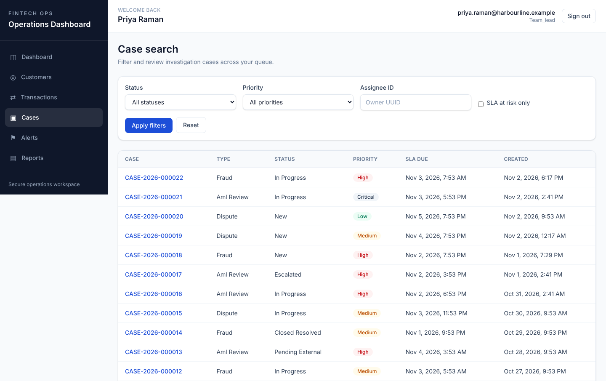
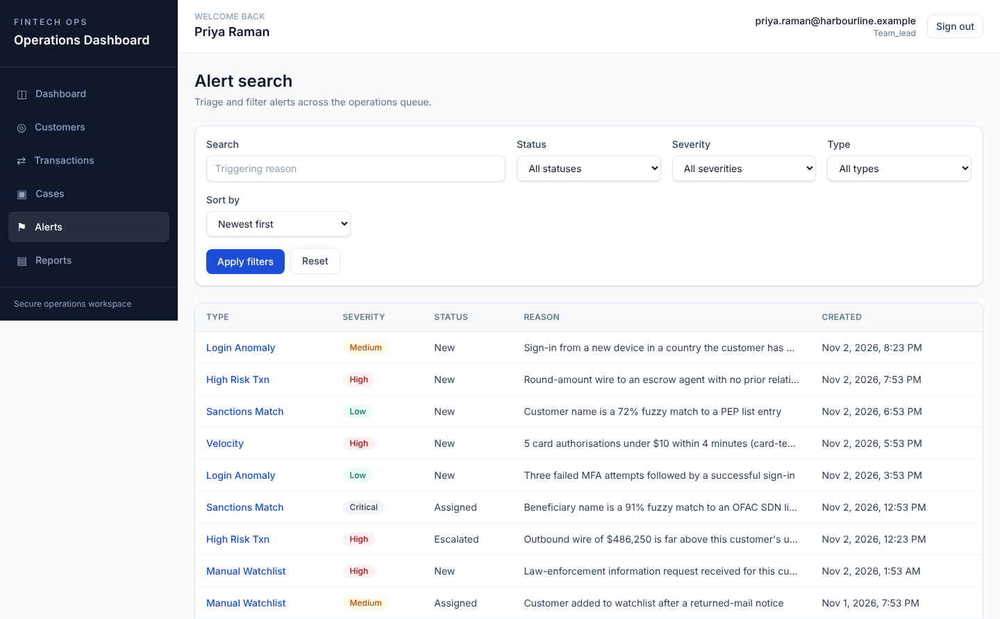
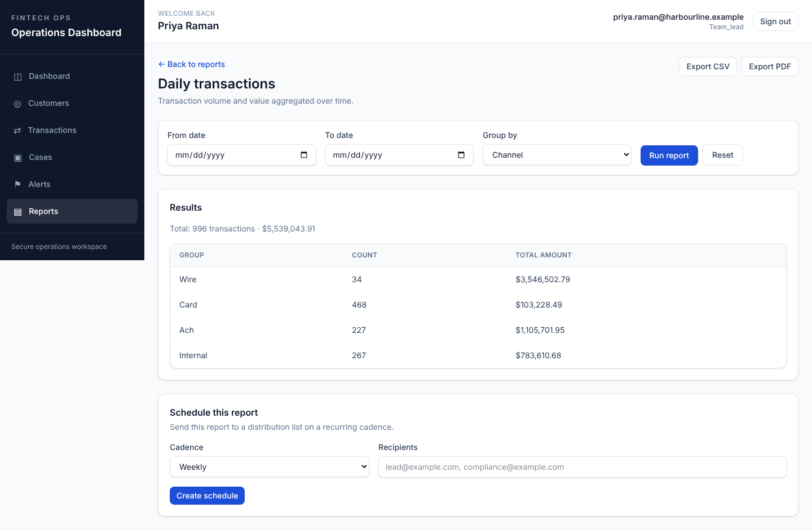

# Fintech Operations Dashboard

An internal operations tool for a fintech support/fraud/compliance desk:
customer search, transaction lookup, case management, alerting, and
reporting, unified behind role-based access control and an audit trail.

## Screenshots

| Case queue | Alert queue | Reports |
|---|---|---|
|  |  |  |

Captured from a demo dataset (`backend/scripts/seed_demo.py`). More in
[`docs/screenshots/`](docs/screenshots/), and a 60-second walkthrough
at [`docs/walkthrough.mp4`](docs/walkthrough.mp4). Full write-up in
[CASE_STUDY.md](CASE_STUDY.md).

- **Backend** — FastAPI + SQLAlchemy (async) + PostgreSQL + Alembic. See
  [backend/README.md](backend/README.md) for the full layout and API modules.
- **Frontend** — React 19 + TypeScript + Tailwind CSS v4 + TanStack Query +
  React Router. See [frontend/README.md](frontend/README.md) for the full
  layout and auth details.
- **Database** — [db/schema.sql](db/schema.sql) is a readable snapshot of the
  schema for reference; the Alembic migrations under `backend/alembic/versions/`
  are the actual source of truth. If you change one, change the other in the
  same commit.
- **Requirements** — [docs/requirements.md](docs/requirements.md) has the full
  functional/non-functional spec and the personas this tool is designed for.

## Running both halves together

```bash
# Terminal 1 — backend
cd backend
python -m venv .venv && .venv\Scripts\activate   # Windows; source .venv/bin/activate elsewhere
pip install -e ".[dev]"
copy .env.example .env                            # edit DATABASE_URL / JWT_SECRET_KEY / ENCRYPTION_KEY
alembic upgrade head
uvicorn app.main:app --reload

# Terminal 2 — frontend
cd frontend
npm install
npm run dev
```

The frontend dev server (`http://localhost:5173`) proxies `/api` to the
backend (`http://localhost:8000`) — see `frontend/vite.config.ts`. In dev
this makes the browser treat both as the same origin, which matters for the
reason below.

## Authentication & cookies

Access tokens live in memory on the frontend only; the refresh token is an
httpOnly cookie the backend sets on `/auth/login` and reads on `/auth/refresh`
— no frontend code ever sees it, which is what keeps it out of XSS's reach.
Two consequences that follow directly from that design, both worth knowing
before changing either half:

- **The frontend and API must be same-site in every environment**, not just
  local dev. A cookie-based refresh flow only works if the browser will send
  the cookie back — same-site subdomains (`app.example.com` /
  `api.example.com` with a shared parent domain and `SameSite=Lax`) work;
  fully separate domains do not, without further cookie configuration this
  project doesn't currently implement. If you deploy the two halves under
  unrelated domains, sessions will silently fail to persist past the access
  token's lifetime — every fetch already sends `credentials: 'include'`, but
  that only helps once the cookie itself can legally travel between the two
  origins.
- **`backend/.env`'s `CORS_ORIGINS`** must list every origin the frontend is
  actually served from (it defaults to `localhost:3000`, which doesn't match
  the frontend's actual dev port, `5173` — the dev proxy masks this locally
  since the browser never makes a cross-origin request to trigger a CORS
  check, but a non-proxied deployment needs the real origin listed).

If you're changing the auth flow on either side, `frontend/src/lib/api.ts`
and `backend/app/api/v1/endpoints/auth.py` are the two files that have to
stay in lock-step — there's no shared contract/codegen between the Pydantic
schemas and the TypeScript types, so a change to one won't be caught by the
type checker on the other side. Update both, and run both test suites.

## Testing & CI

| | Command | CI |
|---|---|---|
| Backend unit/integration | `cd backend && pytest -q` | [.github/workflows/backend-ci.yml](.github/workflows/backend-ci.yml) |
| Frontend unit | `cd frontend && npm run test` | [.github/workflows/frontend-ci.yml](.github/workflows/frontend-ci.yml) (`test` job) |
| Frontend E2E (Playwright, full stack) | `cd frontend && npm run test:e2e` | [.github/workflows/frontend-ci.yml](.github/workflows/frontend-ci.yml) (`e2e` job) |

Both backend tests and the E2E suite need a real Postgres instance — see each
package's README for the one-time database setup.
